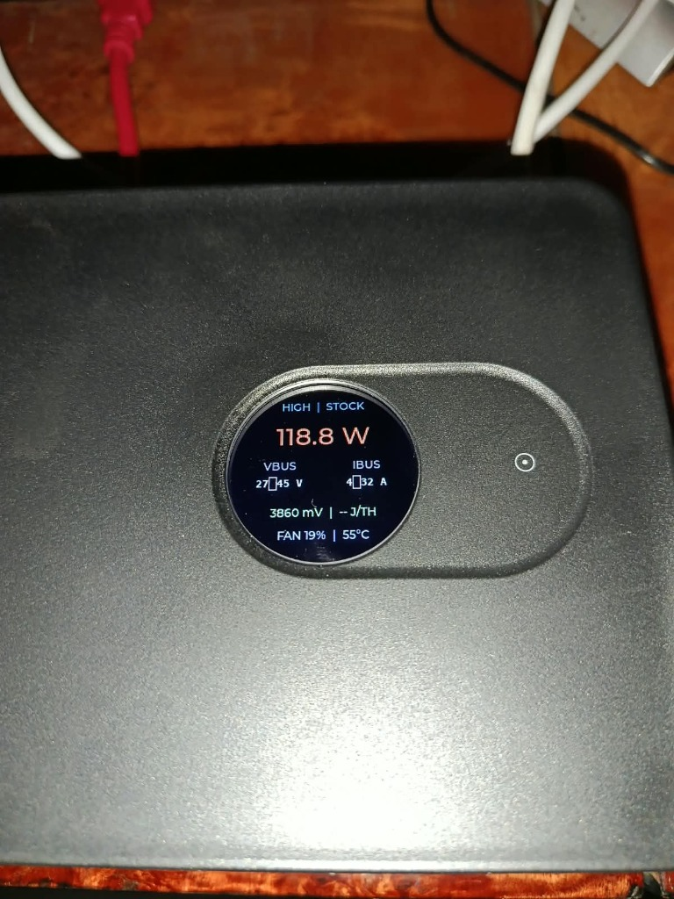
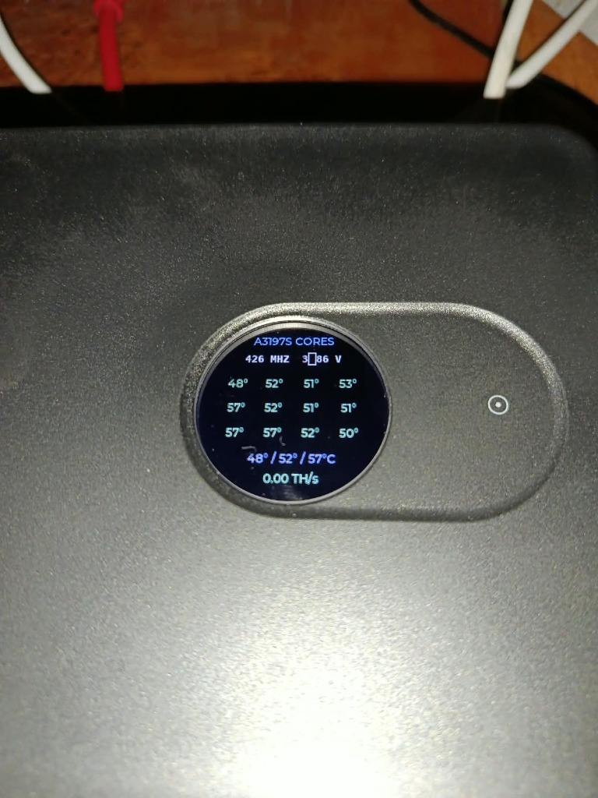

# Phosphor OS — OC / UC / UV & Extended LCD Telemetry for Canaan Avalon Nano 3S

> **Custom `app_ubi` firmware build for Canaan Avalon Nano 3S** based on **Phosphor OS**, adding an **8-mode hardware-aligned UC / UV / Eff OC / OC tuning switch** in the Web UI and **3 new live 240×240 round LCD telemetry screens** (Power Bus, 12× A3197S Core Temps, and Live W/V/A Power Chart).

*(Polska wersja opisu znajduje się poniżej / Polish description below.)*

---

## Live Preview on Device

  
  &nbsp;&nbsp;
  

*(Note: the v3 release also fixes the missing `.` glyph by switching to `lv_font_montserrat_14` and adds Screen 4: Live W/V/A `lv_chart`.)*

---

## Download Ready-to-Flash Firmware

| File | Partition | Size | SHA-256 |
| :--- | :--- | ---: | :--- |
| [`firmware/Phosphor_OS_Nano3S_OC_v3.kdimg`](firmware/Phosphor_OS_Nano3S_OC_v3.kdimg) | `app_ubi` only (`0x04200000`) | 4,915,200 B | `CA0178D0C288E1126A2B7BAF68482D65EA1080D851336FCE7CACC8EC39D3110F` |

Because this `.kdimg` contains **only the `app_ubi` partition** (1 partition, identical to Phosphor OS), flashing it **preserves** your `data_ubi`, factory ASIC calibration, Wi-Fi/LAN configuration, pools, `rootfs_ubi`, Linux kernel, and bootloader.

---

## Features

### 1. 8-Mode Tuning Switch (`UC / UV / Eff OC / OC`) in Web Dashboard
Disassembly of `power_set_vol` (`0x0004c0b6`) in `mm_miner` revealed that the onboard VRM DAC operates in exact **26 mV** hardware steps around `3600 mV` (`step = (V - 3600) / 26`). All voltage offsets are aligned to exact multiples of `26 mV` so every step produces a deterministic hardware VRM change.

Presets are applied on top of your miner's **factory per-mode calibration** (`LOW` / `MED` / `HIGH`), saved persistently to `/data/userdata/phosphor-oc.conf`, and applied live from the Web UI without rebooting:

| Conf Value | Button | PLL Offset | Vcore Offset (DAC Steps) | Power Cap Offset | Purpose |
| :---: | :---: | :---: | :---: | :---: | :--- |
| `oc 1` | **UC -2** | `-40 MHz` | `-52 mV` (`-2` steps) | `-12 W` | Ultra-cool / quiet low-power operation |
| `oc 2` | **UC -1** | `-20 MHz` | `-26 mV` (`-1` step) | `-6 W` | Mild underclock + undervolt |
| `oc 3` | **UV** | `0 MHz` | `-26 mV` (`-1` step) | `-3 W` | Pure undervolt at factory clocks (better J/TH) |
| *(none)* | **Stock** | `0 MHz` | `0 mV` (`0` steps) | `0 W` | Factory Phosphor OS calibration |
| `oc 4` | **Eff OC** | `+20 MHz` | `-26 mV` (`-1` step) | `+4 W` | **Efficiency OC** — sweet spot for `HIGH` under 140 W USB-PD |
| `oc 5` | **OC +1** | `+20 MHz` | `+26 mV` (`+1` step) | `+7 W` | Mild overclock |
| `oc 6` | **OC +2** | `+35 MHz` | `+52 mV` (`+2` steps) | `+10 W` | Medium overclock (best on `LOW` / `MED` or cooled `HIGH`) |
| `oc 7` | **OC +3** | `+50 MHz` | `+78 mV` (`+3` steps) | `+12 W` | Maximum preset (watch ASIC temps & 140 W PD limit) |

**Hard-coded safety clamps in `mm_miner`:**
- Power limit: `45 W – 145 W`
- Core voltage (`Vcore`): `3200 mV – 3750 mV`
- ASIC PLL frequency: `120 MHz – 520 MHz`
- Factory thermal protection (`100%` fan by `90 °C`) remains 100% active.

---

### 2. 6-Screen 240×240 Round LCD Rotation
Short-pressing the front capacitive touch button now cycles through **6 screens** in the following order:

| # | Screen | `show_id` | Description |
| :-: | :--- | :-: | :--- |
| **1** | **Main Dashboard** | `1` | Original Phosphor OS main screen (TH/s, mode, time, IP, power) |
| **2** | **Power Bus Telemetry** | `25` | Active mode & tuning preset (`HIGH \| EFF OC`), large DC Watts (`32 px`), symmetric `VBUS (V)` & `IBUS (A)`, `Vcore (mV) \| J/TH`, `FAN % \| Max °C` |
| **3** | **12× A3197S Cores** | `26` | Live PLL `MHz` & `Vcore`, symmetric 3×4 grid of all 12 ASIC chip temperatures from `g_pvt_temp` (color-coded: mint `<75°C`, amber `75–81°C`, red `≥82°C`), `Min / Avg / Max °C`, and `TH/s` |
| **4** | **Power Live Chart** | `27` | Real-time 48-second 3-series LVGL `lv_chart` (`176×104 px`): **Watts** (`#F3A965`, 0–150 W), **Volts** (`#8DC5FF`, 20–30 V), and **Amps** (`#9AEF9E`, 0–6 A), with live numeric legend and `TH/s \| °C` footer |
| **5** | **Analog Clock** | `2` | Original Avalon / Phosphor watch screen |
| **6** | **Custom Logo** | `3` | Original custom logo screen |

All three new screens update every `1000 ms` via LVGL timers (`lv_timer_create`), using `/run/phosphor-lcd-telemetry` (`LCDV2`), `g_cali_info`, and `g_pvt_temp`.

---

## Technical Architecture

Everything is built deterministically from the base Phosphor OS `app_ubi` image using a custom two-pass **RISC-V64 macro-assembler** in [`scripts/build_phosphor_oc_v3.py`](scripts/build_phosphor_oc_v3.py) and exact-size **UBIFS in-place deflate recompression** in [`scripts/test_exact_deflate.py`](scripts/test_exact_deflate.py):

### `mm_miner` (RISC-V64 ELF, UBIFS `ino=118`)
- **Code placement (zero ELF section resizing, zero UBIFS TNC/LPT changes):**
  - **Block A (`0x00607900–0x00607ed8`, `bno=478`)**: `phosphor_apply_oc`, LCD rotation/dispatch hooks, `read_lcdv2`, `make_lbl` helper, OC/UC signed offset table, and rodata strings (`"STATUS=S,"` at `0x006078a8` preserved untouched).
  - **Block B (`0x000cf000–0x000cfd80`, `bno=191`)**: Placed inside the unused LVGL `lv_spangroup` widget (`lv_draw_span`) in `.text`; contains `init_power_screen`, `update_power_screen`, `init_cores_screen`, `update_cores_screen`, `init_chart_screen`, and `update_chart_screen`.
  - **Runtime `.bss` scratch (`0x005ef700–0x005ef808`)**: After `__BSS_END__` (`0x005ef698`), stores active `oc_lvl` and LVGL object/series pointers.
- **5 minimal hooks:**
  1. `cali_param_get` (`0x0003b9e0`) → `phosphor_apply_oc` (reads `/data/userdata/phosphor-oc.conf`, applies clamped signed offsets).
  2. `lcd_regular_show_switch` (`0x000450b6` & `0x000450f2`) → 6-screen rotation (`1 → 25 → 26 → 27 → 2 → 3 → 1`) while copying only upper 16-bit flags/priority from `lcd_const_table`.
  3. `lcd_hardware_update` (`0x00045432`) → routes `show_id` `25 / 26 / 27` directly to `lcd_update(show_id, 0)`.
  4. `get_screen_index` (`0x0004a9b4`) → maps `25 → 18`, `26 → 19`, `27 → 20`.
  5. `lcd_switch_screen` (`0x0004a5f6`) → lazily initializes and returns `scr_power`, `scr_cores`, or `scr_chart` for `ui_idx` `18 / 19 / 20`.

### Web UI (`dashboard.html`, UBIFS `ino=77`)
- Keeps exact file length (`44,022 B`) and fits every modified UBIFS 4 KB data block (`bno=5..10`) within its original compressed byte length using exact-length raw deflate (`test_exact_deflate.py`).
- Adds the `Tuning (UC / UV / OC)` card with 8 preset buttons, shares atomic `mktemp + mv` config persistence with cooling settings, and triggers a clean `workmode` re-apply so new clocks/voltages take effect immediately.

---

## Flashing Instructions

1. Download [`firmware/Phosphor_OS_Nano3S_OC_v3.kdimg`](firmware/Phosphor_OS_Nano3S_OC_v3.kdimg).
2. Verify SHA-256: `CA0178D0C288E1126A2B7BAF68482D65EA1080D851336FCE7CACC8EC39D3110F`.
3. Flash using **Avalon Family** app / **FMS** / standard Canaan `.kdimg` firmware upgrade method (only `app_ubi` is updated).
4. After reboot:
   - Open the miner's Web UI and select a preset in **Tuning (UC / UV / OC)** (recommended starting points on `HIGH`: **`UV`** or **`Eff OC`**).
   - Tap the front touch button to cycle through all 6 LCD screens.

---

## Opis po polsku

Zmodyfikowany obraz **Phosphor OS** dla koparki **Canaan Avalon Nano 3S** (tylko partycja `app_ubi` pod `0x04200000` — wgranie **nie kasuje** kalibracji, ustawień Wi-Fi, pul ani partycji `data_ubi`).

### Co zawiera wersja v3
1. **8-stopniowy przełącznik `Tuning (UC / UV / OC)` w panelu Web**:
   - Dopasowany do sprzętowego kroku przetwornicy VRM DAC (**26 mV**): `UC -2`, `UC -1`, `UV`, `Stock`, `Eff OC`, `OC +1`, `OC +2`, `OC +3`.
   - Ustawienie zapisuje się trwale w `/data/userdata/phosphor-oc.conf` i wchodzi w życie od razu bez restartu koparki.
   - Wbudowane limity bezpieczeństwa w `mm_miner`: moc `45–145 W`, napięcie rdzeni `3200–3750 mV`, zegar PLL `120–520 MHz` (fabryczna ochrona termiczna `100%` wentylatora przy `90 °C` pozostaje aktywna).
2. **6 ekranów na okrągłym wyświetlaczu LCD 240×240** (przełączanych przyciskiem dotykowym):
   1. **Ekran główny** (hashrate, tryb, godzina, IP, moc)
   2. **Zasilanie (`Power Bus`)** — tryb + preset OC/UC, duża moc DC (`W`), `VBUS (V)` i `IBUS (A)`, `Vcore (mV) | J/TH`, `FAN % | Max °C`
   3. **12 Rdzeni ASIC (`A3197S CORES`)** — aktualne `MHz` i `Vcore`, siatka 3×4 temperatur wszystkich 12 układów ASIC z kolorowaniem (`<75°C` zielony, `75–81°C` pomarańczowy, `≥82°C` czerwony), `Min / Avg / Max °C` oraz `TH/s`
   4. **Wykres prądowy na żywo (`POWER LIVE`)** — 3-seryjny wykres `lv_chart` z ostatnich 48 s: **Waty** (pomarańczowy, `0–150 W`), **Volty** (błękitny, `20–30 V`) i **Ampery** (zielony, `0–6 A`) z aktualnymi wartościami i stopką `TH/s | °C`
   5. **Zegar**
   6. **Własne logo**
3. **Poprawka czcionki (v3)** — zastąpienie niepełnej czcionki 17 px czcionką `lv_font_montserrat_14` z pełnym zestawem znaków ASCII (prawidłowe kropki dziesiętne `.` zamiast prostokątów).

---

## Disclaimer

Modifying ASIC miner firmware, voltages, and clock frequencies is done **at your own risk**. Monitor ASIC temperatures and USB-PD power supply load (especially on `OC +2` / `OC +3`). Built on top of **Phosphor OS** for Canaan Avalon Nano 3S.
