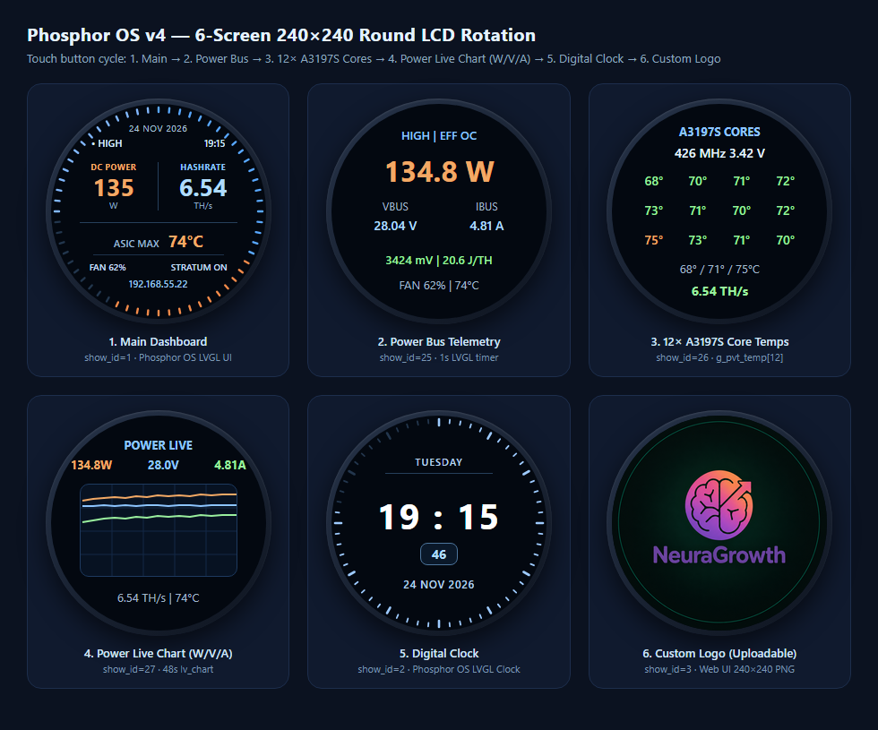

# Phosphor OS v5 - OC / UC / UV, Extended LCD Telemetry, Block Fireworks & Full Device Control for Canaan Avalon Nano 3S

<p align="center">
  <a href="https://ko-fi.com/neuragrowth">
    
  </a>
  &nbsp;
  
  &nbsp;
  
</p>

> Custom `app_ubi` firmware build for **Canaan Avalon Nano 3S** based on **Phosphor OS**. Adds an 8-mode hardware-aligned UC / UV / Eff OC / OC tuning switch, full RGB LED effect and real brightness scaling, custom 240x240 logo upload (Screen 6), Web UI Reboot and Power Off with proper `Goodbye` / `Night Mode` LCD icon triggers, 3 new live 240x240 round LCD telemetry screens (Power Bus, 12x A3197S Core Temps, and Live W/V/A Power Chart), plus a special animated **BLOCK FOUND!** fireworks screen that activates when a solo block is found.
>
> **Full Avalon Family app compatibility:** Initial setup on a new miner, Bluetooth/Wi-Fi pairing, and regular control through the official **Avalon Family** mobile app remain unchanged and continue to work normally.

*(Polska wersja opisu znajduje się poniżej / Polish description below.)*

---

## 6-Screen 240x240 Round LCD Rotation (+ Event-Only Block Fireworks Screen)

<p align="center">
  
</p>

Short-pressing the front touch button cycles through all 6 normal screens:

| # | Screen | `show_id` | Description |
| :-: | :--- | :-: | :--- |
| **1** | **Main Dashboard** | `1` | Phosphor OS main screen (date, mode, time, DC Power, Hashrate, ASIC Max °C, Fan %, Stratum, IP, segmented ring) |
| **2** | **Power Bus Telemetry** | `25` | Active mode & preset (`HIGH \| EFF OC`), large DC Watts (`32 px`), symmetric `VBUS (V)` & `IBUS (A)`, `Vcore (mV) \| J/TH`, `FAN % \| Max °C` |
| **3** | **12x A3197S Cores** | `26` | Live PLL `MHz` & `Vcore`, symmetric 3x4 grid of all 12 ASIC chip temperatures from `g_pvt_temp` (green `<75°C`, amber `75-81°C`, red `>=82°C`), `Min / Avg / Max °C`, and `TH/s` |
| **4** | **Power Live Chart** | `27` | Real-time 48-second 3-series LVGL `lv_chart` (`176x104 px`): **Watts** (`#F3A965`, 0-150 W), **Volts** (`#8DC5FF`, 20-30 V), and **Amps** (`#9AEF9E`, 0-6 A), with live numeric values and `TH/s \| °C` footer |
| **5** | **Digital Clock** | `2` | Phosphor OS digital clock with 60-second perimeter tick ring, weekday, seconds badge and date |
| **6** | **Custom Logo** | `3` | Default logo (`logo_b.png`) or your own 240x240 PNG/JPG/WebP uploaded directly from the Web UI |
| *Event* | **BLOCK FOUND! Fireworks** | `21` *(event-only)* | Animated 8-spark 4-color fireworks screen (`BLOCK / FOUND! / BTC SOLO WIN!`) that only activates when `Found Blocks` increments (or via the **Test Block** button in the **Diagnostics** tab). Not part of the regular button rotation; tap the front button to return to normal screens. |

---

## Redesigned System Status Icons (Animated Perimeter Ring)

All 12 system, startup, network, and alert screens (`assets_lcd/screen_pic/*.png`) have been redesigned in a dark style with a color-coded animated perimeter ring (green for active/ready states, cyan for system/setup states, amber for warnings and maintenance alerts):

<p align="center">
  
</p>

- **Status & Lifecycle**: `Welcome` (`hi.png`), `Goodbye` (`bye.png`), `Mining Start` (`9.png`), `App Connected` (`8.png`), `Night Mode` (`7.png`), `Network Setup` (`2.png`)
- **Diagnostics & Alerts**: `Check Wi-Fi` (`4.png`), `Check Pool` (`3.png`), `No USB Device` (`no_usb.png`), `Power Adapter` (`6.png`), `Cooling Down` (`5.png`), `Clean Filter` (`filter.png`)

---

## Web Dashboard & Tabs

### Overview (Telemetry, Live Charts, 8-Mode Tuning + OC Disclaimer, Cooling, Full RGB LED, Custom Logo & Power Controls)
<p align="center">
  
</p>

### ASICs, Diagnostics & Pools Tabs
<p align="center">
  
  &nbsp;
  
</p>
<p align="center">
  
</p>

---

## Downloads (Firmware v5 & Official Flashing Tools)

| File | Description | Size | SHA-256 / Info |
| :--- | :--- | ---: | :--- |
| [`firmware/Phosphor_OS_Nano3S_OC_v5.kdimg`](firmware/Phosphor_OS_Nano3S_OC_v5.kdimg) | **Firmware v5** (`app_ubi` only, `0x04200000`) | 4.69 MB | `54854B97281F38B01472E6C9DABEB1E7F3F3701BEF198E1FB9CC2F8EA8EACE04` |
| [`tools/AvalonHomeSeriesFirmwareUpgradeTool-windows-v2.2.1-0-gc3a400c-c137.zip`](tools/AvalonHomeSeriesFirmwareUpgradeTool-windows-v2.2.1-0-gc3a400c-c137.zip) | **Original Canaan Avalon Home Series Firmware Upgrade Tool (Windows v2.2.1)** | 50.19 MB | Official Windows flasher |
| [`tools/flash_linux.sh`](tools/flash_linux.sh) | **Linux CLI Flasher Script** (`x86_64` / `arm64`, uses official [`kendryte/k230_flash`](https://github.com/kendryte/k230_flash/releases)) | 2 KB | Linux CLI + [`k230_burning_tool`](https://github.com/kendryte/k230_burning_tool/releases) GUI |

Because `Phosphor_OS_Nano3S_OC_v5.kdimg` contains **only the `app_ubi` partition** (1 partition, same as base Phosphor OS), flashing it preserves your `data_ubi`, factory ASIC calibration, Wi-Fi/LAN configuration, pools, `rootfs_ubi`, Linux kernel, and bootloader.

---

## What's New in v5 (from Hardware Testing of v4)

1. **Fixed LED Brightness Slider**: `mm_miner` (`led_colorset` / `led_inner_colorset`) writes raw 24-bit RGB directly to WS2812 without applying the brightness parameter. v5 scales the RGB channels by `brightness / 100` in the Web UI before sending `ledset`, so the 10-100% brightness slider visibly dims/brightens the LEDs.
2. **Fixed Custom Logo Upload (`Err` on 240x240 PNG)**: `cg_miner` (`http_post_file_handler`) enforces a hard 1000-byte request buffer limit on `POST /usrdata`. v5 reduces upload chunks to `640 B` with live `%` progress and adds a format hint (`Logo: PNG/JPG/WebP (240x240)`) right under the button.
3. **Removed Non-Functional `Filter N/A`**: The Avalon Nano 3S has no hardware filter counter/sensor (`estats` never reports `Filter[...]`), so the dead `Filter N/A` label and disabled `Reset filter` button were removed from the `Device` card.
4. **Fixed `Goodbye` (`bye.png`) & `Night Mode` (`7.png`) LCD Icons**: Added a lightweight `/run/p_*` trigger hook in `mm_miner` (`updata_lcd_data` -> `hook_lcd_poll`). **Power Off** now displays `GOODBYE` (`bye.png`) for 1.5 s before running `sync && poweroff` (preventing Wi-Fi teardown from flashing `Check Wi-Fi`), and **Night mode** displays `NIGHT MODE` (`7.png`) for 1.4 s before blanking the backlight.
5. **New Event-Only `BLOCK FOUND!` Fireworks Screen**: Activates automatically when `Found Blocks` increases in `cg_miner` `summary` (polled every 15 s), or on demand via the **Test Block** button in the **Diagnostics** tab.

---

## What's Included in v5

### 1. 8-Mode Tuning Switch (`UC / UV / Eff OC / OC`)
Disassembly of `power_set_vol` (`0x0004c0b6`) in `mm_miner` showed that the onboard VRM DAC works in exact **26 mV** hardware steps around `3600 mV` (`step = (V - 3600) / 26`). All voltage offsets are aligned to multiples of `26 mV`:

| Conf Value | Button | PLL Offset | Vcore Offset (DAC Steps) | Power Cap Offset | Purpose |
| :---: | :---: | :---: | :---: | :---: | :--- |
| `oc 1` | **UC -2** | `-40 MHz` | `-52 mV` (`-2` steps) | `-12 W` | Ultra-cool / quiet low-power operation |
| `oc 2` | **UC -1** | `-20 MHz` | `-26 mV` (`-1` step) | `-6 W` | Mild underclock + undervolt |
| `oc 3` | **UV** | `0 MHz` | `-26 mV` (`-1` step) | `-3 W` | Pure undervolt at factory clocks (better J/TH) |
| *(none)* | **Stock** | `0 MHz` | `0 mV` (`0` steps) | `0 W` | Factory Phosphor OS calibration |
| `oc 4` | **Eff OC** | `+20 MHz` | `-26 mV` (`-1` step) | `+4 W` | **Efficiency OC** - sweet spot for `HIGH` under 140 W USB-PD |
| `oc 5` | **OC +1** | `+20 MHz` | `+26 mV` (`+1` step) | `+7 W` | Mild overclock |
| `oc 6` | **OC +2** | `+35 MHz` | `+52 mV` (`+2` steps) | `+10 W` | Medium overclock (best on `LOW` / `MED` or well-cooled `HIGH`) |
| `oc 7` | **OC +3** | `+50 MHz` | `+78 mV` (`+3` steps) | `+12 W` | Maximum preset (watch ASIC temps and 140 W PD limit) |

**Hard-coded safety clamps in `mm_miner`:**
- Power limit: `45 W - 145 W`, Core voltage (`Vcore`): `3200 mV - 3750 mV`, PLL frequency: `120 MHz - 520 MHz`
- Factory thermal protection (`100%` fan by `90 °C`) remains active.

### 2. Full RGB LED Control (Effect, Color & Working Brightness)
- Direct Web UI control over `ascset|0,ledset,<effect>-<brightness>-50-<R>-<G>-<B>`:
  - **Effects**: `Solid` (`1`), `Flash` (`2`), `Breath` (`3`), `Rainbow` (`4`), `Off` (`0`)
  - Full 24-bit RGB color picker and working 10-100% brightness slider (scales RGB values directly for WS2812).

### 3. Custom Logo Upload for Screen 6 (`PNG / JPG / WebP`, auto-formatted to `240x240 PNG`)
- Click **Upload Logo** in the **Device** card and pick any `.png`, `.jpg`, or `.webp` image.
- The browser automatically center-crops and masks it into a circular **240x240 PNG**, uploads it reliably in 640-byte chunks to `/data/userconfig/wallpaper/wallpaper_0.png`, and keeps it across reboots.
- Click **Reset Logo** at any time to restore the built-in logo.

### 4. Power Management (Reboot & Power Off)
- **Reboot** (`ascset|0,reboot,0`) and **Power Off** (displays `GOODBYE` icon for 1.5 s, then runs `sync && poweroff`) buttons in the **Device** card with confirmation prompts for safe shutdown without corrupting UBIFS.

### 5. Official Avalon Family App Compatibility
- First-time setup on a fresh miner, Bluetooth/Wi-Fi pairing, and regular operation through the official **Avalon Family** app are completely unchanged and continue to work alongside the Web UI.

---

## Full Changelog vs. Stock Canaan Firmware (`2025061101_4ba23e3`)

This build is based on the latest official **Avalon Nano 3S stock firmware (`2025061101_4ba23e3`)** with the **Phosphor OS** base layer and **v5** extensions. Only the `app_ubi` partition is modified (`mm_miner`, `cg_miner`, Web UI HTML, and `assets_lcd`). `rootfs_ubi`, `data_ubi`, kernel, bootloader, and factory ASIC calibration remain untouched.

| Subsystem | Modified Files / Functions | What Changed vs. Stock `2025061101_4ba23e3` |
| :--- | :--- | :--- |
| **USB-PD & Power Supply** | `mm_miner`: `power_is_valid`, `is_power_i2c_ok`, `get_pd_max_mode`, `pd_init`, `pd_get_max_power`, `power_primary_polling`, `hashrate_calibration` | Removes strict OEM power-adapter lockout and PD I2C check (`power_is_valid` -> `1`, `is_power_i2c_ok` -> `1`) and unlocks `HIGH` mode (`get_pd_max_mode` -> `2`) so third-party 140 W+ USB-PD 3.1 EPR or 28 V DC power supplies can run all modes without false *Unsupported Adapter* lockouts. *(Note: you are responsible for using a PSU rated for the selected power level, at least 140 W for `HIGH` / OC.)* |
| **OC / UC / UV Tuning** | `mm_miner`: `cali_param_get` (`0x3b9e0`), `Block A` | Adds 8-mode live tuning (`UC -2`, `UC -1`, `UV`, `Stock`, `Eff OC`, `OC +1..+3`) aligned to exact **26 mV** hardware VRM DAC steps, saved in `/data/userdata/phosphor-oc.conf`, with hard safety clamps (`45-145 W`, `3200-3750 mV`, `120-520 MHz`). |
| **Cooling & Fan Curve** | `mm_miner`: `misc_thread` (`0x3b148`) | Adds custom Auto temperature target (`50-85 °C`) and 5-point manual PWM fan curve saved in `/data/userdata/phosphor-cooling.conf`, while keeping factory thermal protection (`100%` fan by `90 °C`), plus live `/run/phosphor-lcd-telemetry` (`LCDV2`) export. |
| **240x240 Round LCD UI** | `mm_miner`: `lcd_screen_info_init`, `lcd_screen_watch_init`, `lcd_screen_img_init`, `lcd_regular_show_switch`, `lcd_hardware_update`, `get_screen_index`, `lcd_switch_screen`, `updata_lcd_data`, `Block B`, `Block C` | Replaces stock main and watch screens with Phosphor OS vector Main Dashboard and 60-tick Digital Clock; adds 3 new live screens (Power Bus, 12x A3197S Core Temps, 48 s W/V/A `lv_chart`) in a 6-screen button rotation; adds event-only animated `BLOCK FOUND!` fireworks screen (`ui_idx=21`) and `/run/p_*` triggers for `Goodbye` and `Night Mode`; replaces all 12 system/alert icons (`assets_lcd/screen_pic/*.png`) with dark icons featuring a color-coded animated perimeter ring. |
| **Web Dashboard & Controls** | `dashboard.html`, `cgpools.html`, `cg_miner` (`http_post_file_handler`) | 4-tab Web UI (`Overview`, `Pools`, `ASICs`, `Diagnostics`) with 120-sample live charts, 8-mode Tuning card + OC warning, fan curve editor, full RGB LED control with working brightness scaling, 640 B chunked Screen 6 custom logo upload/reset, Reboot / Power Off with `Goodbye` icon, `Night mode` icon preview, and `Test Block` button in `Diagnostics`. |
| **Avalon Family App** | Unchanged | First-time onboarding, Bluetooth/Wi-Fi pairing, and regular mobile app control work identically to stock firmware. |

---

## Technical Architecture

Built from the base Phosphor OS `app_ubi` image using a two-pass **RISC-V64 macro-assembler** in [`scripts/build_phosphor_oc_v5.py`](scripts/build_phosphor_oc_v5.py) and exact-size **UBIFS in-place deflate recompression** in [`scripts/test_exact_deflate.py`](scripts/test_exact_deflate.py):

- **Block A (`0x00607900-0x00607f6c`, `bno=478`)**: `phosphor_apply_oc`, LCD rotation/dispatch hooks, `read_lcdv2`, `make_lbl`, OC/UC offset table, fireworks burst vectors/colors, and rodata strings (`"STATUS=S,"` at `0x006078a8` preserved untouched).
- **Block B (`0x000cf000-0x000d0000`, `bno=191`)**: Placed inside the unused LVGL `lv_spangroup` widget (`lv_draw_span`) in `.text`; contains `init_power_screen`, `update_power_screen`, `init_cores_screen`, `update_cores_screen`, `init_chart_screen`, `update_chart_screen`, `init_block_screen`, and `anim_block_screen` (120 ms 8-spark fireworks animation timer).
- **Block C (`0x000cee60-0x000ceef4`, `bno=190`)**: Placed inside the unused `lv_spangroup_event` function in `.text`; contains `chk_t` and `hook_lcd_poll` (polls `/run/p_blk`, `/run/p_bye`, `/run/p_ngt` on every `updata_lcd_data` tick).
- **6 hooks in `mm_miner`**: `cali_param_get` (`0x3b9e0`), `lcd_regular_show_switch` (`0x450b6`/`0x450f2`), `lcd_hardware_update` (`0x45432`), `get_screen_index` (`0x4a9b4`), `lcd_switch_screen` (`0x4a5f6`), and `updata_lcd_data` (`0x4a6c0`).
- **Web UI (`dashboard.html`, `ino=77`)**: Exact `44,022 B` length with auto-balanced UBIFS 4 KB deflate blocks (`bno=5..10`), checked with `node --check` and full UBIFS CRC32/zlib verification (`1,561` nodes, `0` errors).

---

## Flashing Instructions

### Windows
1. Download [`firmware/Phosphor_OS_Nano3S_OC_v5.kdimg`](firmware/Phosphor_OS_Nano3S_OC_v5.kdimg) and unpack [`tools/AvalonHomeSeriesFirmwareUpgradeTool-windows-v2.2.1-0-gc3a400c-c137.zip`](tools/AvalonHomeSeriesFirmwareUpgradeTool-windows-v2.2.1-0-gc3a400c-c137.zip).
2. Verify SHA-256 of the `.kdimg` file: `54854B97281F38B01472E6C9DABEB1E7F3F3701BEF198E1FB9CC2F8EA8EACE04`.
3. Run **Avalon Home Series Firmware Upgrade Tool**, select `Phosphor_OS_Nano3S_OC_v5.kdimg`, connect your Avalon Nano 3S in upgrade mode, and flash (only `app_ubi` is updated).

### Linux (`x86_64` / `arm64`)
1. Run the included Linux flasher script (verifies SHA-256, downloads official `k230_flash_cli`, and flashes to `SPI_NAND`):
   ```bash
   chmod +x tools/flash_linux.sh
   sudo ./tools/flash_linux.sh
   ```
2. If you prefer a Linux desktop GUI, download official [`kendryte/k230_burning_tool`](https://github.com/kendryte/k230_burning_tool/releases) and select `SPI_NAND` + `firmware/Phosphor_OS_Nano3S_OC_v5.kdimg`.

### After Reboot
- If this is a new device, pair and set it up normally using the official **Avalon Family** app.
- Open the Web UI in your browser to configure **Tuning (UC / UV / OC)**, **RGB LED**, **Custom Logo**, or **Cooling**.
- Tap the front touch button to cycle through all 6 LCD screens.
- Open the **Diagnostics** tab and click **Test Block** to preview the animated `BLOCK FOUND!` fireworks screen on your LCD.

---

## Opis po polsku

Kompletna nakładka firmware **Phosphor OS v5** dla koparki **Canaan Avalon Nano 3S** (tylko partycja `app_ubi` pod `0x04200000` - wgranie nie kasuje kalibracji, Wi-Fi, pul ani partycji `data_ubi`). W katalogu `tools/` dołączony jest oryginalny program do wgrywania dla Windows oraz skrypt flashera dla Linuxa (`tools/flash_linux.sh`, korzystający z oficjalnego `kendryte/k230_flash`).

**Zgodność z oryginalną aplikacją Avalon:** Sposób pierwszej konfiguracji przy nowym sprzęcie, parowanie przez Bluetooth/Wi-Fi oraz normalna obsługa przez oryginalną aplikację **Avalon Family** pozostają bez zmian i działają tak samo jak na fabrycznym firmware.

### Co poprawiono i dodano w wersji v5
1. **Działający suwak jasności LED (`10-100%`)**:
   - W `mm_miner` funkcja `led_colorset` przekazywała czyste RGB na diody WS2812 bez uwzględnienia parametru jasności. W v5 panel skaluje kanały R/G/B przez wartość suwaka przed wysłaniem komendy `ledset`, dzięki czemu regulacja jasności działa płynnie.
2. **Naprawione wgrywanie własnego logo na 6. ekran + opis formatu**:
   - `cg_miner` ma twardy limit `1000 B` na bufor żądania `POST /usrdata`, przez co większe paczki zwracały `Err`. W v5 obraz jest wysyłany w porcjach po `640 B` z paskiem postępu `%`, a przy przycisku widnieje jasna informacja: `Logo: PNG/JPG/WebP (240x240)`.
3. **Usunięty niedziałający licznik `Filter N/A`**:
   - Avalon Nano 3S nie posiada sprzętowego czujnika ani licznika filtra (stąd `N/A` również w oficjalnej aplikacji). Z karty `Device` usunięto martwy napis i nieaktywny przycisk `Reset filter`.
4. **Poprawione ikony `Goodbye` przy wyłączaniu i `Night Mode` przy trybie nocnym**:
   - Dodano lekki hook `hook_lcd_poll` w `mm_miner` (na plikach `/run/p_*`): **Power Off** wyświetla ikonę `GOODBYE` (`bye.png`) przez 1.5 s zanim wykona `sync && poweroff` (zamiast błędu `Check Wi-Fi`), a **Night mode** pokazuje ikonę `NIGHT MODE` (`7.png`) przez 1.4 s przed zgaszeniem podświetlenia LCD.
5. **Nowy ekran fajerwerków `BLOCK FOUND!` (tylko po trafieniu bloku)**:
   - Animowany ekran 8-iskrowych fajerwerków (`BLOCK / FOUND! / BTC SOLO WIN!`), który nie pojawia się w normalnej rotacji 6 ekranów, tylko aktywuje się automatycznie po wzroście `Found Blocks` w `summary` (lub na żądanie przyciskiem **Test Block** w zakładce **Diagnostics**). Dotknięcie przycisku na obudowie wraca do zwykłej rotacji.
6. **Pełny zestaw funkcji z poprzednich wersji**:
   - 8-stopniowy przełącznik `Tuning (UC / UV / OC)` dopasowany do kroku DAC `26 mV` + ostrzeżenie OC, 6 ekranów LCD 240x240, 12 ikon systemowych z animowaną obwódką, odblokowanie zasilaczy USB-PD 140 W+ / 28 V DC oraz 5-punktowa krzywa wentylatora.

---

## Support the Project / Wesprzyj projekt

If this firmware helped you get more out of your Avalon Nano 3S, consider buying a coffee on Ko-fi!  
Jeśli ten projekt okazał się pomocny dla Twojej koparki Avalon Nano 3S, możesz postawić kawę na Ko-fi:

<p align="center">
  <a href="https://ko-fi.com/neuragrowth">
    
  </a>
</p>

---

## Disclaimer / Ostrzeżenie

> **WARNING:** Overclocking, undervolting, and modifying ASIC miner firmware are done at your own risk and may permanently damage your hardware or void warranty. This software is provided "as is" with no warranty and no liability for hardware damage, data loss, or electrical issues. Always monitor ASIC temperatures and USB-PD power supply load (especially on `OC +2` / `OC +3`).
